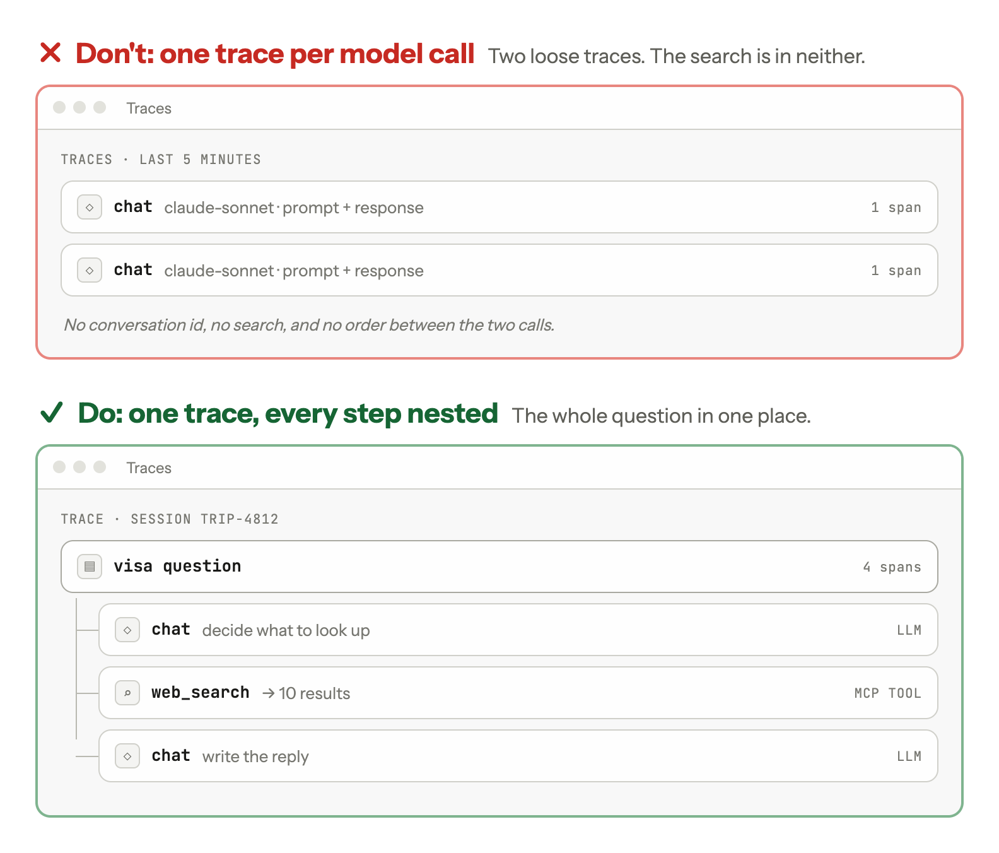

<div align="center">

# good-agent-tracing

An agent skill that adds, audits and fixes tracing for AI agents, so a person or an LLM judge can
see what the agent did and where it went wrong.

[](LICENSE)
[](https://agentskills.io)
[](https://opentelemetry.io)
[](SKILL.md)
[](https://www.glassray.ai)



</div>

---

An agent traced only by its LLM SDK's auto-instrumentation records each model call as a separate
trace, with no search results, no question or answer on the root, and no record of which version
ran. Give this skill to your coding agent and it does three things.

1. It audits your tracing. It checks the code against 16 items, such as "every tool call's
   output is recorded" and "secrets are removed before export", and reports each as ok, partial or
   missing, with the file and line.
2. It fixes what the audit finds, one item at a time, without changing what the agent does.
3. It adds tracing to an agent that has none.

It uses OpenTelemetry, so the traces work in any backend that accepts OTLP: Glassray, Langfuse,
LangSmith, Braintrust, Arize Phoenix, Jaeger and others. It runs in Claude Code, Cursor and OpenAI
Codex, and in other agents that read the [Agent Skills](https://agentskills.io) format.

## Before and after

[`examples/before.py`](examples/before.py) is a travel assistant that answers visa questions with a
web search. Its only tracing is the LLM SDK's auto-instrumentation:

```python
trace.set_tracer_provider(TracerProvider())
trace.get_tracer_provider().add_span_processor(SimpleSpanProcessor(OTLPSpanExporter()))
AnthropicInstrumentor().instrument()
```

The audit finds 13 of the 16 items missing and 2 partial (one doesn't apply). The rows that matter
most ([full report](examples/audit-before.md)):

| # | Item | Status | Evidence | What's wrong |
| --- | --- | --- | --- | --- |
| 2 | Every step under one root span | missing | no span around `answer()` (`before.py:31`) | You can't see which search fed which reply |
| 5 | Request and answer on the root | missing | no root span | The trace list shows no question and no answer |
| 8 | Every tool call's input and output | missing | `web_search` (`before.py:26`) has no span | When a reply is wrong, you can't tell whether the search missed the rule or the model ignored it |
| 10 | Empty results and failures | missing | `.get("results", [])` (`before.py:28`) | A search that failed inside a 200 looks the same as one that found nothing |

[`examples/after.py`](examples/after.py) is the same agent after Fix mode. The prompt, model and
tools are unchanged. One user message is now one trace: the question and the reply on the root,
each model call with its full prompt and tokens, and each search with every result. The audit of
the fixed version has 13 items ok, 2 partial and 1 that doesn't apply
([full report](examples/audit-after.md)). The two partial items are left on purpose: structuring
the reply would mean changing the prompt, and the system prompt is still recorded on every model
call.

## The checklist

#### Structure

1. One task per trace
2. Every step under one root span
3. Ids that connect traces (`session.id`, your own ids, span links)
4. Metadata to filter by
5. Request and answer on the root, detail on each step

#### What to record

6. Each model call: full prompt, response, model and tokens
7. The instructions as text
8. Every tool call's input and output
9. For RAG: every chunk in full, which were kept, and the final prompt
10. Empty results and failures recorded explicitly
11. The final answer as structured fields

#### Comparing versions

12. Which version ran: commit, uncommitted changes, prompt hashes
13. Human feedback linked to the answer

#### Safe and affordable

14. Cut repetition, not evidence
15. Tracing never breaks the agent
16. Secrets and personal data removed before export

The reasoning and an example for each item are in [references/rules.md](references/rules.md). The
long-form guide is [What to do to make your AI traces useful](https://www.glassray.ai/blog/make-ai-traces-useful).

## Install

The skill is the whole folder: `SKILL.md` loads files from `references/`, so copy all of it. The
Agent Skills format requires the folder name to match the `name` in `SKILL.md`, which is
`good-agent-tracing`.

### Claude Code

For every project:

```bash
git clone https://github.com/glassray/good-agent-tracing ~/.claude/skills/good-agent-tracing
```

For one repository, clone it into `.claude/skills/good-agent-tracing` at the repository root
instead. Claude Code picks the skill up on its own when a request matches its description, and
`/good-agent-tracing` runs it directly.

### Cursor

Cursor reads skills from `.cursor/skills/` or `.agents/skills/` in a project, and from
`~/.cursor/skills/` for every project ([Cursor docs](https://cursor.com/docs/skills)). It also
reads `.claude/skills/`, so a copy installed for Claude Code works in Cursor without a second copy.

```bash
git clone https://github.com/glassray/good-agent-tracing ~/.cursor/skills/good-agent-tracing
```

### OpenAI Codex

Codex reads skills from `.agents/skills/` in the repository and from `~/.agents/skills/` for every
project ([Codex docs](https://developers.openai.com/codex/skills)).

```bash
git clone https://github.com/glassray/good-agent-tracing ~/.agents/skills/good-agent-tracing
```

### Other agents

Any agent that reads `SKILL.md` folders takes the same folder; put it wherever that agent looks for
skills. For a tool without skill support, add the contents of `SKILL.md` to its instructions file
and keep `references/` next to it, so the links resolve.

## Using it

Ask for one of the three modes, for example:

- "Audit the tracing in this agent"
- "Fix the top three items from the audit"
- "Add tracing to the support agent in `src/agent`"

When the request is vague ("our traces are useless"), the skill audits first and shows the report
before changing any code. When you haven't picked a tracing backend, it sets up a console exporter
and asks before sending data anywhere.

## What's in the repository

| Path | What it holds |
| --- | --- |
| [SKILL.md](SKILL.md) | The checklist and how to add, audit or fix tracing |
| [references/rules.md](references/rules.md) | Each item with the reasoning and an example |
| [references/python.md](references/python.md) | OpenTelemetry setup and helpers for Python |
| [references/typescript.md](references/typescript.md) | OpenTelemetry setup and helpers for TypeScript |
| [references/audit.md](references/audit.md) | The audit report format |
| [examples/](examples/) | The travel assistant before and after, and both audits |
| [docs/](docs/) | The image at the top of this page |

## License

MIT, see [LICENSE](LICENSE). The skill is maintained by [Glassray](https://www.glassray.ai).
